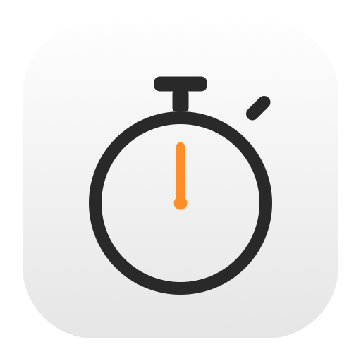

<div align="center">
  
  <h1>Clock Elapsed</h1>
  <p><strong>Your stopwatch. Now in the menu bar.</strong></p>
  <p>A small companion to Apple's Clock. Keep the stopwatch you already use, and see elapsed time at a glance.</p>
  <p>
    <a href="LICENSE"></a>
    
    
    
  </p>
  <p><strong>English</strong> · <a href="README.zh-CN.md">简体中文</a></p>
  <p><a href="https://github.com/baojiachen0214/clock-elapsed/releases">Download</a> · <a href="#why-it-exists">Why it exists</a> · <a href="#get-started">Get started</a> · <a href="docs/ARCHITECTURE.md">How it works</a> · <a href="https://github.com/baojiachen0214/clock-elapsed/issues">Feedback</a></p>
</div>

---

## A little more Clock

**Clock Elapsed adds a menu bar readout to the stopwatch in Apple's Clock.** Clock remains where you start, pause, reset and record laps. This companion brings its elapsed time into view while you work in another app.

It is a focused extension of that workflow: one stopwatch, one source of time, one glance.

## Why it exists

The idea came from a small interruption: a countdown was already visible in the menu bar, while checking the stopwatch meant bringing Clock forward. Starting another stopwatch in a separate app would create a second timer to manage.

Clock Elapsed fills that gap. Start the stopwatch in Clock, return to your work, and keep elapsed time in the menu bar. Click the readout to return directly to Clock's Stopwatch page.

## What you get

- **Your existing stopwatch.** Mirrors Clock's elapsed time; no separate start, pause or reset controls.
- **Quiet presence.** Whole seconds, a distinct stopwatch symbol, system typography and animated digit changes. No Dock icon, regular windows or context menus.
- **Follows Clock.** The companion opens when Clock launches and exits when Clock quits. A small event-driven watcher stays available for the next launch.
- **Long sessions.** Hours expand as needed, including `99:59:59 → 100:00:00`.
- **Local by design.** No account, analytics, network requests or third-party runtime dependencies.
- **English and Simplified Chinese.** Localized interface strings and a parser for English/Chinese durations and Unicode decimal digits.

Clock's countdown keeps its own system menu bar item. Clock Elapsed adds the stopwatch readout alongside it. Hold **Command** and drag to arrange the items; macOS controls the spacing between them.

## Get started

### Download and install

Download the **[latest Release](https://github.com/baojiachen0214/clock-elapsed/releases)**. Open the `.dmg`, double-click **Install Clock Elapsed.app**, and click **Install**. No Xcode, Python, terminal commands or administrator password are needed. Allow the installed app's Accessibility access once, then open Clock → Stopwatch.

The download is a **Developer ID signed preview, not yet Apple-notarized**. macOS may block the first launch. If you trust the download, try opening the installer once, then use **System Settings → Privacy & Security → Open Anyway**. See [Apple's instructions](https://support.apple.com/en-us/102445). Universal binaries include Apple silicon and Intel; only macOS 27.2.1 on Apple silicon has been integration-tested. SHA-256 checksums are included in the Release.

### Build from source

### 1. Build and install

Requires Xcode Command Line Tools and a macOS SDK with AppKit and SwiftUI.

```sh
git clone https://github.com/baojiachen0214/clock-elapsed.git
cd clock-elapsed
./test.sh
./build.sh
./install.sh
```

The app is installed at `~/Applications/ClockElapsed.app`. Installation also registers a watcher for your user account; no administrator password is needed. The build targets macOS 14 or later. The current implementation has been exercised on **macOS 27.2.1, Apple silicon**; other versions and Intel Macs need integration testing.

### 2. Allow access once

Allow **Clock Elapsed** in **System Settings → Privacy & Security → Accessibility**. The section's name varies by macOS version and language; on the tested Chinese macOS 27 system it appears as **设备控制和数据访问**.

If you need the system permission prompt:

```sh
open -g ~/Applications/ClockElapsed.app --args --setup
```

The permission lets the companion read Clock's stopwatch display and navigate to Stopwatch when clicked. It never starts, pauses or resets your stopwatch or countdowns.

### 3. Use Clock as usual

Open Clock, select **Stopwatch**, and start or resume it. Once synchronized, switch to another app. The readout shows whole elapsed seconds; a reset, paused stopwatch takes no menu bar space. Closing Clock's window keeps Clock running; quitting Clock closes the companion.

### Remove automatic startup

```sh
./uninstall.sh
```

This stops the companion and removes its watcher registration. It keeps the app in `~/Applications`; delete that app separately if desired. See [setup and troubleshooting](docs/SETUP.md) for signing, updates and permission issues.

## How synchronization works

Clock Elapsed uses public macOS Accessibility APIs to read Clock's interface. It does **not** subscribe to an official Clock stopwatch data API.

Clock can stop refreshing its exposed value when hidden or on another tab. After a successful synchronization, the companion continues locally from a continuous-time anchor, then recalibrates when fresh Clock data returns. Hover over the item to see whether it is synced, paused or continuing locally.

Important limits:

- On a fresh launch, open Stopwatch once to establish a current reading. A frozen old value alone cannot establish the current running time.
- Changes made while Clock exposes stale data, including through Siri, cannot be reflected until Clock provides a fresh reading.
- Live readings are truncated rather than rounded. Hidden local continuation remains subject to the synchronization limit above.
- Clock's interface can change between macOS releases. Sleep/wake integration and more locales still need testing.

## Small by design

There is no continuous drawing loop. Source reads run off the main thread, once per second while Clock is active and every three seconds in the background. Parsed values and discovered elements are cached; animation reuses one view. Hidden readouts release that view.

The Objective-C watcher sleeps between app lifecycle events. It has no polling timer, windows, Swift runtime or Accessibility access. AppKit and SwiftUI still have a baseline memory cost; this project does not claim zero leaks or a fixed memory footprint. See [architecture](docs/ARCHITECTURE.md) for the implementation and validation boundaries.

## Contribute

Bug reports, macOS compatibility results, translations and focused improvements are welcome. Please read [Contributing](CONTRIBUTING.md), the [Code of Conduct](CODE_OF_CONDUCT.md), and the [Security policy](SECURITY.md). Keep user-facing text in localization resources.

[MIT licensed](LICENSE). Independent community project; not affiliated with or endorsed by Apple. Apple Clock and macOS are Apple products. The app icon is drawn by this project's own source; system symbols are supplied by macOS.
