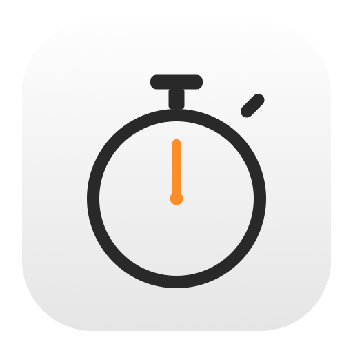

<div align="center">
  
  <h1>Clock Elapsed</h1>
  <p><strong>系统秒表，抬眼可见。</strong></p>
  <p>给 macOS「时钟」补上菜单栏秒表显示，沿用你已经在用的秒表。</p>
  <p>
    <a href="LICENSE"></a>
    
    
    
  </p>
  <p><a href="README.md">English</a> · <strong>简体中文</strong></p>
</div>

---

## 给「时钟」补上一点点

**Clock Elapsed 是系统「时钟」的功能补充。** 开始、暂停、复位和计次依然在「时钟」中完成；它把同一个秒表的已用时间放进菜单栏，让你在其他应用里工作时也能看见。

它不另起一套需要单独操作的计时流程。时间来自你已有的系统秒表。

## 为什么做这个

起因是一个很小的打断：倒计时已经能在菜单栏看到，而查看秒表的已用时间还需要切回「时钟」。如果另外开一个计时软件，又多了一份需要同步开始、暂停和复位的时间。

所以我们做了这层补充：在系统秒表中开始计时，回到手头的工作，菜单栏继续显示已用时间；点击数字，直接回到「时钟」的秒表页。

## 它带来了什么

- **沿用系统秒表。** 镜像已用时间，不添加第二套开始、暂停或复位按钮。
- **保持安静。** 只显示秒表图标和整秒时间，使用系统字体及数字过渡，没有 Dock 图标、普通窗口和右键菜单。
- **跟随「时钟」。** 随「时钟」启动和退出；轻量监听器留在后台，等待下次启动。
- **支持长时间计时。** 小时位数按需扩展，包括 `99:59:59 → 100:00:00`。
- **本地运行。** 无账号、统计分析、网络请求和第三方运行时依赖。
- **英文与简体中文。** 界面文字使用本地化资源，时间解析兼容中英文时长及 Unicode 十进制数字。

倒计时继续使用系统自己的菜单栏项目。Clock Elapsed 只补上秒表显示。按住 **Command** 拖动可以调整位置，独立项目之间的间距由 macOS 控制。

## 开始使用

当前是**早期源码预览**，尚无经过公证的安装包。

### 1. 编译并安装

需要 Xcode Command Line Tools，以及包含 AppKit、SwiftUI 的 macOS SDK。

```sh
git clone https://github.com/baojiachen0214/clock-elapsed.git
cd clock-elapsed
./test.sh
./build.sh
./install.sh
```

安装位置为 `~/Applications/ClockElapsed.app`，同时为当前用户注册启动监听器，不需要管理员权限。构建目标为 macOS 14 及以上；目前在 **macOS 27.2.1、Apple silicon** 上使用和检查，其他系统版本及 Intel 设备仍需集成测试。

### 2. 授予一次读取权限

在**系统设置 → 隐私与安全性 → 辅助功能**中允许 Clock Elapsed。不同系统版本的名称可能不同，已测试的 macOS 27 中文系统中显示为**设备控制和数据访问**。

需要系统权限提示时，可以运行：

```sh
open -g ~/Applications/ClockElapsed.app --args --setup
```

权限用于读取「时钟」的秒表显示，以及点击菜单栏数字后切换到秒表页。它不会启动、暂停或复位你的秒表、倒计时。

### 3. 像平常一样使用「时钟」

打开「时钟」的**秒表**页，开始或继续计时，完成同步后即可切回其他应用。菜单栏显示整秒；已复位且暂停的秒表不占用菜单栏空间。关闭窗口不等于退出「时钟」；退出「时钟」后，伴侣应用也会退出。

### 停用自动跟随

```sh
./uninstall.sh
```

这会停止伴侣应用并移除监听器注册，保留应用本体。如需彻底移除，可另行删除 `~/Applications/ClockElapsed.app`。签名、更新和权限排查见[安装说明（英文）](docs/SETUP.md)。

## 同步的边界

项目通过 macOS 公开的辅助功能接口读取「时钟」界面，没有使用官方的秒表数据订阅接口。

「时钟」隐藏或切换页面后，公开的时间读数可能冻结。成功同步后，项目会根据连续时钟在本地续计，待系统再次提供新读数时校准。悬停提示会说明当前处于同步、暂停还是本地续计状态。

- 全新启动时需要打开一次秒表页，冻结的旧读数无法推断当前运行时间。
- 系统读数冻结期间，经 Siri 等途径发生的变化，需等到新读数出现后才能感知。
- 实时读数向下取整，不提前进位；隐藏后的本地续计仍受上述同步边界限制。
- 系统界面可能随版本变化，睡眠唤醒的集成验证及更多语言兼容仍待完善。

## 轻量的实现

没有持续绘制循环。读取在后台队列进行：「时钟」处于前台时每秒一次，后台每三秒一次；复用已解析的读数和已找到的界面元素，动画复用一个视图，项目隐藏时释放它。

Objective-C 监听器只响应应用启动、退出事件，没有轮询计时器、窗口、Swift 运行时或辅助功能权限。AppKit 与 SwiftUI 仍有基础内存开销，项目不宣称零泄漏或固定的内存占用。实现细节见[架构说明（英文）](docs/ARCHITECTURE.md)。

## 参与项目

欢迎反馈问题、提供系统兼容性结果、补充翻译和改进实现。请阅读[贡献指南](CONTRIBUTING.md)、[行为准则](CODE_OF_CONDUCT.md)和[安全政策](SECURITY.md)。新增界面文字应使用本地化资源。

采用 [MIT 许可](LICENSE)。这是独立社区项目，与 Apple 无关联，也未经 Apple 背书。Apple Clock 与 macOS 属于 Apple 产品；应用图标由项目代码绘制，系统符号由 macOS 提供。
